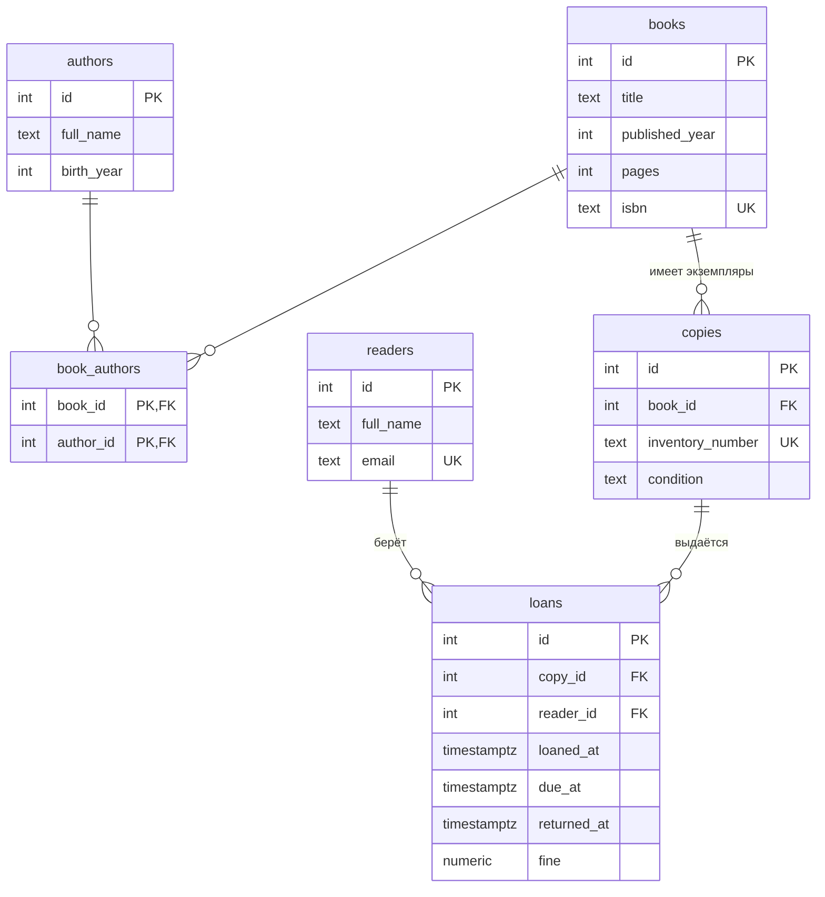

# Библиотека

Тема № 2: **Библиотека**. База хранит книги, авторов, физические экземпляры, читателей и выдачи; нужна библиотекарю, чтобы знать, у кого какая книга и когда её вернуть.

| | |
| --- | --- |
| Главная таблица | `loans` (выдачи) |
| Связь N:M | `books` и `authors` через `book_authors` |
| Бизнес-правило | Не больше 5 книг на руках у одного читателя |
| СУБД | PostgreSQL 17 в Docker |

## Задания курса

Правила курса, установка и порядок сдачи: [docs/README.md](docs/README.md).

| Лаба | Задание |
| --- | --- |
| 1. Модель данных и схема | [docs/lab-1.md](docs/lab-1.md) |
| 2. Запросы | [docs/lab-2.md](docs/lab-2.md) |
| 3. Логика в базе | [docs/lab-3.md](docs/lab-3.md) |
| 4. Транзакции и доступ | [docs/lab-4.md](docs/lab-4.md) |
| 5. Производительность | [docs/lab-5.md](docs/lab-5.md) |
| Витрина к защите | [docs/showcase.md](docs/showcase.md) |

## Как запустить

```bash
cp .env.example .env          
docker compose up -d          
dbcheck run demo/lab1.sql    
```

Работа с базой: `docker compose exec db psql -U postgres -d app`. Сценарии выполняются в `psql` командой `\i /demo/lab1.sql`.

После изменения скриптов в `db/` базу нужно пересоздать: `docker compose down -v && docker compose up -d`.

## ER-диаграмма



Связующая таблица `book_authors`: у книги может быть несколько авторов, а у автора несколько книг.

## Ограничения

| Ограничение | Таблица и колонки | Зачем |
| --- | --- | --- |
| `UNIQUE` | `books(isbn)` | у каждой книги свой ISBN, дублей быть не может |
| `UNIQUE` | `copies(inventory_number)` | инвентарный номер однозначно определяет экземпляр |
| `UNIQUE` | `readers(email)` | один email на одного читателя |
| `CHECK` | `books(pages)`, `books(published_year)`, `authors(birth_year)` | числа должны быть положительными |
| `CHECK` | `copies(condition)` | состояние только `good`, `worn` или `damaged` |
| `CHECK` | `loans(fine)` | штраф не может быть отрицательным |
| `CHECK` | `loans(due_at > loaned_at)` | срок возврата позже момента выдачи |
| `CHECK` | `loans(returned_at IS NULL OR returned_at >= loaned_at)` | книгу нельзя вернуть раньше, чем выдали |

## Что сделано по лабам

| Лаба | Что сделано | Сценарий |
| --- | --- | --- |
| 1 | Схема из 6 таблиц, ключи и ограничения, тестовые данные, генерация 1000+ строк, три плохие вставки | `demo/lab1.sql` |
| 2 | ... | `demo/lab2.sql` |
| 3 | ... | `demo/lab3.sql` |
| 4 | ... | `demo/lab4.sql`, `demo/race.sql`, `demo/race_fixed.sql` |
| 5 | ... | `demo/lab5.sql` |

## Нормализация

Исходная плоская таблица, в которой всё хранится в одном месте:

`loan_flat(loan_id, loaned_at, reader_name, reader_email, book_title, isbn, authors, inventory_number, condition)`

| loan_id | reader_name | reader_email | book_title | isbn | authors | inventory_number |
| --- | --- | --- | --- | --- | --- | --- |
| 1 | Иван Петров | ivan@example.com | Пикник на обочине | 978-5-0000-0005-9 | Аркадий Стругацкий, Борис Стругацкий | INV-005 |
| 2 | Иван Петров | ivan@example.com | Пикник на обочине | 978-5-0000-0005-9 | Аркадий Стругацкий, Борис Стругацкий | INV-015 |

**Где повторы.** Имя и email читателя записаны в каждой его выдаче. Название, ISBN и список авторов книги записаны в каждой выдаче любого её экземпляра. Если читатель сменит email или в названии найдут опечатку, править придётся много строк, и где-то останется старое значение.

**1НФ: в каждой ячейке одно значение.** В поле `authors` список через запятую. Выносим авторов в таблицу `authors`, а связь с книгами в `book_authors` (по строке на пару книга-автор).

**2НФ: неключевые столбцы зависят от всего ключа.** Название и ISBN зависят только от книги, а не от выдачи. Выносим их в `books`. Инвентарный номер и состояние зависят от экземпляра, выносим в `copies`.

**3НФ: неключевые столбцы не зависят друг от друга.** Имя и email определяются читателем, а не выдачей. Выносим в `readers`. В `loans` остаются только ссылки на экземпляр и читателя и данные самой выдачи (даты, штраф).

## Типы данных

| Что хранится | Тип | Почему |
| --- | --- | --- |
| Штраф (`loans.fine`) | `numeric(10, 2)` | деньги нельзя хранить во `float`: он хранит числа приближённо |
| Даты выдачи и возврата | `timestamptz` | момент времени с учётом часового пояса |
| Состояние экземпляра (`copies.condition`) | `text` + `CHECK (condition IN (...))` | допустимы только три значения |
| Ключи | `integer GENERATED ALWAYS AS IDENTITY` | искусственный номер, который выдаёт сама база |

Статус выдачи (на руках или возвращена) отдельной колонкой не хранится: он выводится из `returned_at` (`IS NULL` значит книга на руках). Так данные не дублируются.

## Что происходит при удалении

| Связь | ON DELETE | Причина |
| --- | --- | --- |
| `book_authors.book_id` → `books` | CASCADE | связь «книга–автор» не нужна без книги |
| `book_authors.author_id` → `authors` | RESTRICT | нельзя удалить автора, пока за ним числятся книги |
| `copies.book_id` → `books` | RESTRICT | нельзя удалить книгу, у которой есть экземпляры |
| `loans.copy_id` → `copies` | RESTRICT | история выдач не должна пропадать |
| `loans.reader_id` → `readers` | RESTRICT | нельзя удалить читателя с историей выдач |

Оговорка: `CASCADE` у `book_authors.book_id` сработает, только если у книги нет экземпляров, потому что `copies` удерживает книгу через `RESTRICT`.

<!--
  Разделы, которые добавляются по ходу курса:
  лаба 4: «Гонка»;
  лаба 5: «Производительность» (таблица до / после, когда индекс не помогает, размеры).
-->