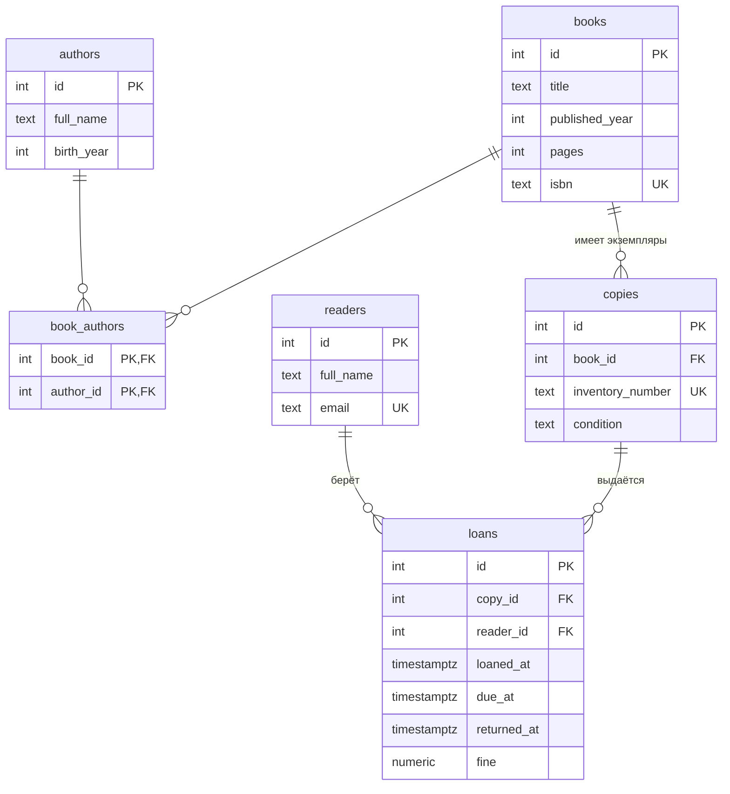

# Библиотека

Тема № 2: **Библиотека**. База хранит книги, авторов, физические экземпляры, читателей и выдачи; нужна библиотекарю, чтобы знать, у кого какая книга и когда её вернуть.

| | |
| --- | --- |
| Главная таблица | `loans` (выдачи) |
| Связь N:M | `books` и `authors` через `book_authors` |
| Бизнес-правило | Не больше 5 книг на руках у одного читателя |
| СУБД | PostgreSQL 17 в Docker |

## Задания курса

Правила курса, установка и порядок сдачи: [docs/README.md](docs/README.md).

| Лаба | Задание |
| --- | --- |
| 1. Модель данных и схема | [docs/lab-1.md](docs/lab-1.md) |
| 2. Запросы | [docs/lab-2.md](docs/lab-2.md) |
| 3. Логика в базе | [docs/lab-3.md](docs/lab-3.md) |
| 4. Транзакции и доступ | [docs/lab-4.md](docs/lab-4.md) |
| 5. Производительность | [docs/lab-5.md](docs/lab-5.md) |
| Витрина к защите | [docs/showcase.md](docs/showcase.md) |

## Как запустить

```bash
cp .env.example .env          
docker compose up -d          
dbcheck run demo/lab1.sql    
```

Работа с базой: `docker compose exec db psql -U postgres -d app`. Сценарии выполняются в `psql` командой `\i /demo/lab1.sql`.

После изменения скриптов в `db/` базу нужно пересоздать: `docker compose down -v && docker compose up -d`.

## ER-диаграмма



Связующая таблица `book_authors`: у книги может быть несколько авторов, а у автора несколько книг.

## Ограничения

| Ограничение | Таблица и колонки | Зачем |
| --- | --- | --- |
| `UNIQUE` | `books(isbn)` | у каждой книги свой ISBN, дублей быть не может |
| `UNIQUE` | `copies(inventory_number)` | инвентарный номер однозначно определяет экземпляр |
| `UNIQUE` | `readers(email)` | один email на одного читателя |
| `CHECK` | `books(pages)`, `books(published_year)`, `authors(birth_year)` | числа должны быть положительными |
| `CHECK` | `copies(condition)` | состояние только `good`, `worn` или `damaged` |
| `CHECK` | `loans(fine)` | штраф не может быть отрицательным |
| `CHECK` | `loans(due_at > loaned_at)` | срок возврата позже момента выдачи |
| `CHECK` | `loans(returned_at IS NULL OR returned_at >= loaned_at)` | книгу нельзя вернуть раньше, чем выдали |

## Что сделано по лабам

| Лаба | Что сделано | Сценарий |
| --- | --- | --- |
| 1 | Схема из 6 таблиц, ключи и ограничения, тестовые данные, генерация 1000+ строк, три плохие вставки | `demo/lab1.sql` |
| 2 | 16 запросов: JOIN (до 4 таблиц), GROUP BY и HAVING, «сироты» через LEFT JOIN, подзапросы (IN, скалярный, NOT EXISTS), INSERT/UPDATE/DELETE в транзакциях с откатом; ★ CTE, ROW_NUMBER, SUM OVER, LAG, рекурсивный CTE | `demo/lab2.sql` |
| 3 | 2 представления, функции issue_book и return_book, триггер лимита в 5 книг, триггер updated_at, журнал loans_audit; материализованное представление и поиск с фильтрами, журнал в jsonb и состояние на дату | `demo/lab3.sql` |
| 4 | Откат транзакции при ошибке, гонка и её исправление через `FOR UPDATE`, роли `app_reader` и `app_writer` с паролями из `.env`; ★ изоляция (`READ COMMITTED` и `REPEATABLE READ`) и взаимоблокировка, ★★ Row Level Security и резервная копия | `demo/lab4.sql`, `demo/race.sql`, `demo/race_fixed.sql`, `demo/isolation_rc.sql`, `demo/isolation_rr.sql`, `demo/deadlock.sql`, `demo/rls.sql` |
| 5 | ... | `demo/lab5.sql` |

## Нормализация

Исходная плоская таблица, в которой всё хранится в одном месте:

`loan_flat(loan_id, loaned_at, reader_name, reader_email, book_title, isbn, authors, inventory_number, condition)`

| loan_id | reader_name | reader_email | book_title | isbn | authors | inventory_number |
| --- | --- | --- | --- | --- | --- | --- |
| 1 | Иван Петров | ivan@example.com | Пикник на обочине | 978-5-0000-0005-9 | Аркадий Стругацкий, Борис Стругацкий | INV-005 |
| 2 | Иван Петров | ivan@example.com | Пикник на обочине | 978-5-0000-0005-9 | Аркадий Стругацкий, Борис Стругацкий | INV-015 |

**Где повторы.** Имя и email читателя записаны в каждой его выдаче. Название, ISBN и список авторов книги записаны в каждой выдаче любого её экземпляра. Если читатель сменит email или в названии найдут опечатку, править придётся много строк, и где-то останется старое значение.

**1НФ: в каждой ячейке одно значение.** В поле `authors` список через запятую. Выносим авторов в таблицу `authors`, а связь с книгами в `book_authors` (по строке на пару книга-автор).

**2НФ: неключевые столбцы зависят от всего ключа.** Название и ISBN зависят только от книги, а не от выдачи. Выносим их в `books`. Инвентарный номер и состояние зависят от экземпляра, выносим в `copies`.

**3НФ: неключевые столбцы не зависят друг от друга.** Имя и email определяются читателем, а не выдачей. Выносим в `readers`. В `loans` остаются только ссылки на экземпляр и читателя и данные самой выдачи (даты, штраф).

## Типы данных

| Что хранится | Тип | Почему |
| --- | --- | --- |
| Штраф (`loans.fine`) | `numeric(10, 2)` | деньги нельзя хранить во `float`: он хранит числа приближённо |
| Даты выдачи и возврата | `timestamptz` | момент времени с учётом часового пояса |
| Состояние экземпляра (`copies.condition`) | `text` + `CHECK (condition IN (...))` | допустимы только три значения |
| Ключи | `integer GENERATED ALWAYS AS IDENTITY` | искусственный номер, который выдаёт сама база |

Статус выдачи (на руках или возвращена) отдельной колонкой не хранится: он выводится из `returned_at` (`IS NULL` значит книга на руках). Так данные не дублируются.

## Что происходит при удалении

| Связь | ON DELETE | Причина |
| --- | --- | --- |
| `book_authors.book_id` → `books` | CASCADE | связь «книга–автор» не нужна без книги |
| `book_authors.author_id` → `authors` | RESTRICT | нельзя удалить автора, пока за ним числятся книги |
| `copies.book_id` → `books` | RESTRICT | нельзя удалить книгу, у которой есть экземпляры |
| `loans.copy_id` → `copies` | RESTRICT | история выдач не должна пропадать |
| `loans.reader_id` → `readers` | RESTRICT | нельзя удалить читателя с историей выдач |

Оговорка: `CASCADE` у `book_authors.book_id` сработает, только если у книги нет экземпляров, потому что `copies` удерживает книгу через `RESTRICT`.

## Резервная копия

    docker compose exec db pg_dump -U postgres -d app -Fc -f /tmp/app.dump
    docker compose exec db createdb -U postgres app_restore
    docker compose exec db pg_restore -U postgres -d app_restore /tmp/app.dump
    docker compose exec db psql -U postgres -d app_restore -c "SELECT count(*) FROM loans"

Число строк в `loans` в `app` и `app_restore` совпадает. Роли в копию не входят: при восстановлении на другом сервере их создаёт `db/21_roles.sql` или `pg_dumpall --roles-only`.

## Row Level Security

Роль `app_member` видит в `loans` только выдачи читателя из настройки `app.reader_id` (`db/22_rls.sql`, `demo/rls.sql`). Владелец таблицы и суперпользователь политики не замечают.

## Гонка

Правило темы: не больше 5 книг на руках у одного читателя. Триггер `trg_check_reader_limit` из лабы 3 считает книги читателя перед вставкой, но на уровне `READ COMMITTED` не видит незафиксированную вставку другой сессии.

Шаги гонки (`demo/race.sql`):

1. У читателя 4 книги на руках, лимит 5.
2. Окно A начинает транзакцию и выдаёт пятую книгу, но ещё не фиксирует.
3. Окно B в тот же момент выдаёт шестую: триггер не видит выдачу окна A, считает 4 книги и пропускает.
4. A и B делают `COMMIT`: на руках 6 книг, правило нарушено (проверка `[check]` возвращает `false`).

Исправление (`db/20_race_fix.sql`, `demo/race_fixed.sql`): функция `lib.issue_book` перед вставкой блокирует строку читателя командой `SELECT ... FOR UPDATE`. Окно B упирается в эту блокировку и ждёт. Когда A делает `COMMIT`, B продолжает, триггер видит уже пятую книгу и отказывает (`[check]` возвращает `true`). Блокируется общая строка, читатель, поэтому две выдачи одному читателю выстраиваются в очередь. Заодно блокируется экземпляр, чтобы одну книгу не выдали двоим. Порядок блокировок всегда один (читатель, потом экземпляр), чтобы не получить взаимоблокировку.

## Роли

`app_reader` читает только представления `lib.v_loan_card` и `lib.v_reader_load`. `app_writer` не меняет таблицы напрямую, а вызывает бизнес-операции `lib.issue_book` и `lib.return_book`, которые работают с правами владельца (`SECURITY DEFINER`). Пароли ролей хранятся в `.env`, в репозитории только `.env.example`.

<!--
  Разделы, которые добавляются по ходу курса:
  лаба 4: «Гонка»;
  лаба 5: «Производительность» (таблица до / после, когда индекс не помогает, размеры).
-->